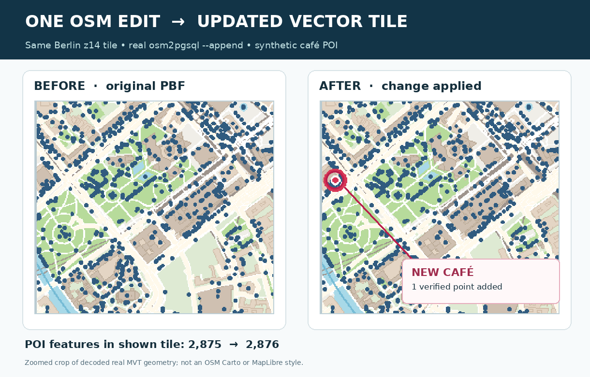
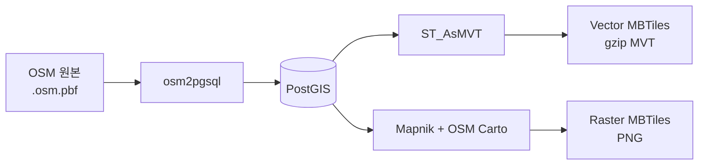
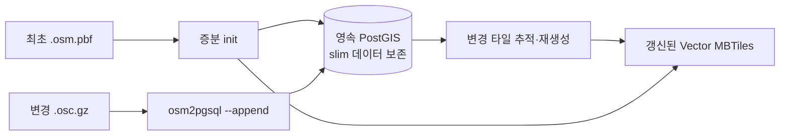
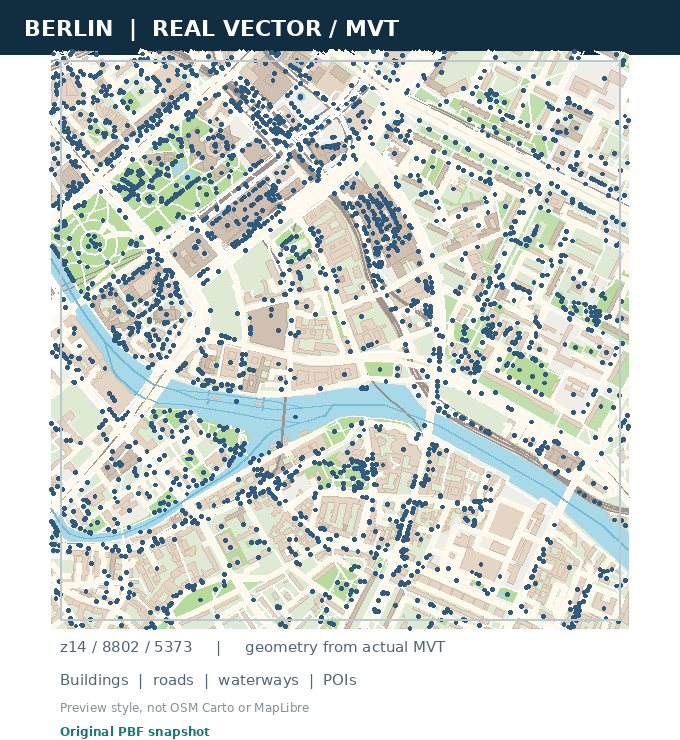

# osm2mbtiles

**OpenStreetMap PBF로 Vector·Raster MBTiles를 만들고, OSM 변경분으로 Vector 타일을 갱신합니다.**

[English README](README.md) · [Vector 레이어·속성 문서](docs/VECTOR-TILE-SCHEMA.md) · [벤치마크](docs/BENCHMARKS.md)

**지속적으로 변경되는 OSM 지도를 위한 타일 파이프라인입니다.** `.osm.pbf`를 **MVT/PBF Vector MBTiles**, Mapnik 기반 **PNG Raster MBTiles**, 또는 두 가지 형식으로 생성합니다. 별도 **영속 PostGIS DB**를 준비하면 `.osc.gz` 변경분을 적용하고 영향받은 Vector 타일을 다시 생성할 수 있습니다. 변경 때마다 PBF 전체를 다시 import할 필요는 없습니다.

**이 프로젝트를 고려할 이유**

- **Vector 증분 업데이트:** osm2pgsql slim 데이터를 보존하는 전용 DB에서 변경분을 적용합니다.
- **Vector + Raster 동시 생성:** 필요한 경우 한 번의 공유 import 경로에서 두 MBTiles를 만듭니다.
- **확인 가능한 출력 스키마:** 19개 MVT 레이어·속성 정보와 증분/전체 재구성 정합성 CI를 제공합니다.

> **실행 전 확인:** 독립 실행 파일이 아닌 소스 기반 프로토타입입니다. Linux 또는 Windows WSL2, PostgreSQL/PostGIS와 osm2pgsql이 필요합니다. 이제 **Vector만 생성할 때는 시스템 PostgreSQL 도구를 사용하고 Mapnik·OSM Carto 없이 실행**할 수 있습니다. Raster·`both`에는 기존 전체 런타임이 필요합니다. [설치 조건과 제약](#설치-조건과-제약)을 참조하세요.

## 실제 증분 업데이트 결과



베를린 고정 PBF로 만든 **동일한 z14 MVT 타일**에 실제 `osm2pgsql --append`로 **검증용 가상 카페 한 개**를 추가했습니다. 해당 `poi` 레이어의 피처 수는 **2,875개 → 2,876개**로 바뀌었습니다. [검증 데이터](docs/assets/readme-preview-evidence.json) · [원본 타일 전체 비교](docs/assets/berlin-incremental-before-after.png)

이미지는 실제 생성된 벡터 지오메트리를 확대·표시한 기술적 미리보기이며, 실제 OSM 최신 데이터나 MapLibre·OSM Carto 지도 스타일의 스크린샷은 아닙니다.

## 빠른 시작

### Windows + WSL2

WSL2 Ubuntu/Debian과 네이티브 런타임을 준비한 뒤, 소스 저장소의 Windows 명령 프롬프트에서 실행합니다.

```bat
run.bat vector 12-14
run.bat both 12-14
```

기존 `.osm.pbf` 파일을 선택하거나 `run.bat`에 드래그해서 지정할 수 있습니다. 서울 전용 수동 검증은 `tests\test-seoul.bat`를 사용하며 기본 실행기와는 별개입니다.

### Linux / WSL — PBF에서 Vector MBTiles 생성

프로젝트 루트에서 **시스템 PostgreSQL/PostGIS와 osm2pgsql**을 준비한 뒤 (Vector 전용은 Mapnik·OSM Carto 불필요):

```bash
python3 -m pip install -e '.[vector]'
python3 -m osm2mbtiles doctor --vector-only

# 베를린 PBF는 미리 다운로드해야 합니다.
python3 -m osm2mbtiles convert berlin-261001.osm.pbf \
  --bbox 13.20,52.45,13.60,52.60 --zoom 12-14 \
  --tile-type vector --output berlin.mbtiles

python3 -m osm2mbtiles verify-vector berlin.mbtiles
```

[Geofabrik Berlin PBF](https://download.geofabrik.de/europe/germany/berlin.html)는 별도로 받아야 합니다. `--bbox`는 PBF 헤더에 영역 정보가 없는 경우에도 사용할 수 있습니다. `--tile-type both --runtime ./runtime`를 사용하면 준비된 전체 런타임으로 공유 import 후 `berlin.vector.mbtiles`와 `berlin.raster.mbtiles`를 생성합니다. 이때 Raster용 Mapnik·OSM Carto 스타일 및 폰트 등 자산이 필요합니다.

### OSM `.osc.gz` 변경분으로 Vector 갱신

일반 `convert` DB는 **append용이 아닙니다**. 먼저 기존 데이터가 없는 전용 PostGIS DB를 준비하고 osm2pgsql slim middle 데이터를 보존해야 합니다.

```bash
# 이미 실행 중인 전용 PostGIS DB의 접속 정보
export PGHOST=/path/to/socket PGPORT=5432 PGUSER=your_user PGDATABASE=gis

python3 -m osm2mbtiles.vector_incremental init \
  --pbf berlin-261001.osm.pbf --output berlin-updated.mbtiles \
  --bbox 13.20,52.45,13.60,52.60 --zoom 12-14

python3 -m osm2mbtiles.vector_incremental append \
  --diff changes.osc.gz --output berlin-updated.mbtiles
```

OSM diff 적용 자체는 완료됐지만 타일 기록이 남아 있을 때만 `python3 -m osm2mbtiles.vector_incremental flush --output berlin-updated.mbtiles`를 사용하세요. 실패 상태가 불명확한 diff를 무조건 재적용하면 안 됩니다. **증분 갱신은 Vector 전용 실험 기능**이며 OSM replication 파일·시퀀스를 자동 다운로드/관리하지 않습니다.

## 언제 osm2mbtiles를 선택할까?

| 주요 목적 | 적합한 도구 | 고려할 제약 |
|---|---|---|
| **OSM diff 기반 Vector 갱신**, **Mapnik 없는 시스템 PostGIS Vector 생성**, 또는 **Vector·PNG Raster 병행 생성** | **osm2mbtiles** | PostGIS·osm2pgsql 설치 필요, 증분은 영속 DB를 요구하는 실험 경로이며 Raster는 별도 전체 런타임 필요 |
| 대규모 PBF의 빠른 **Vector 전체 생성** | [Planetiler](https://github.com/onthegomap/planetiler#readme) | 공식 README에서 실시간 증분 반영 없이 전체 PBF import를 사용한다고 설명 |
| DB 없이 독립 실행 파일 중심의 **일회성 Vector 생성** | [Tilemaker](https://github.com/systemed/tilemaker#readme) | 공식 README에서 지속적으로 최신 OSM 데이터를 반영하려는 경우에는 권하지 않음 |

**경쟁 우위는 검증되지 않은 변환 속도가 아니라 사용 흐름의 차이입니다.** 초기 설치가 간편하거나 전체 Vector 재생성이 주목적이라면 Planetiler·Tilemaker가 더 나은 선택일 수 있습니다. 서로 다른 레이어 스키마와 작업량을 고려하지 않은 성능 우위는 주장하지 않습니다. [비교 기준](docs/BENCHMARKS.md).

## 동작 구조





입력 OSM PBF와 출력 Vector MBTiles 내부의 MVT/PBF는 **서로 다른 파일 형식**입니다. Raster는 원본 PBF로부터 별도의 Mapnik 경로를 통해 PNG를 생성합니다. 증분 적용 시 유도 label-point 데이터 갱신 과정은 변경된 객체에만 한정되지 않을 수 있습니다.

## Vector 출력과 속성



Vector MBTiles에는 아래 **19개 논리 레이어**가 생성될 수 있습니다. 레이어별로 최소 줌·피처 존재 여부가 다르므로 모든 타일에 모든 레이어가 있는 것은 아닙니다.

| 분류 | 레이어 ID |
|---|---|
| 도로·교통 | `road`, `pathway`, `railway`, `transport`, `aeroway` |
| 물·지표면 | `water`, `waterway`, `landcover`, `landuse`, `leisure` |
| 건물·시설 | `building`, `building_part`, `aeroway_area`, `power` |
| 장소·주소 | `place`, `poi`, `housenumber` |
| 경계 | `boundary`, `boundary_legal` |

생성 속성 `class`와 `osm_id`는 문자열입니다. 원본 OSM 태그는 일부만 출력되며 **z0–12에서는 20개**, **z13 이상에서는 74개** 키를 허용합니다. 모든 피처가 모든 속성을 갖는 것은 아닙니다.

**[Vector 레이어·속성 전체 스키마](docs/VECTOR-TILE-SCHEMA.md)** — 레이어별 최소 줌, 지오메트리, 필터, `class` 우선순위, 전체 속성 목록, MapLibre 예제와 실제 MBTiles 데이터 확인 방법.

## 실시간 진행 상황 표시

Windows+WSL2 실행기와 CLI는 `[CHECK]`, `[SETUP]`, `[IMPORT]`, `[RASTER]`, `[VECTOR]`, `[STAGE]`, `[TIME]` 등의 단계를 표시합니다. Raster·기본 Vector·실험적 Vector Batch 변환에서는 **실제 완료된 XYZ 타일 수**를 기준으로 퍼센트, tiles/s 및 ETA를 계산합니다.

```text
[STAGE] 3/5 — Importing PBF and exporting tiles (progress shown per phase)
[IMPORT] osm2pgsql still running | elapsed=00:20 | total work unknown
[RASTER] START | total=100 tiles | metatiles=3 | already-complete=20 | 20.0%
[RASTER]  60.0% | 60/100 tiles | 8.0 tiles/s | ETA 00:00:05
```

숫자는 **출력 형식 예시**이며 실제 성능 수치가 아닙니다. Raster는 동일 작업의 부분 MBTiles가 남아 있으면 이미 완료된 타일을 진행률에 포함합니다. 하나의 Mapnik 메타타일 렌더링이나 SQL 실행이 오래 걸리는 동안에도 `WORKING`/경과 시간 알림이 나옵니다. 반면 PBF 가져오기·외부 GIS 자산 다운로드는 전체 작업량을 정확히 계산하기 어려우므로 **임의의 퍼센트나 ETA를 표시하지 않고** 작업 중임과 경과 시간만 보여줍니다. 타일 생성 후 최종 MBTiles 무결성 검사는 별도로 진행됩니다.

## 설치 조건과 제약

- **공통:** 소스 체크아웃, Linux/Windows WSL2, Python 3.10+, PostgreSQL/PostGIS, osm2pgsql이 필요합니다.
- **Vector 전용:** `python3 -m pip install -e '.[vector]'`로 psycopg2를 설치하고 시스템 PostgreSQL 실행 파일을 사용합니다. `--runtime` 번들과 **Mapnik·OSM Carto는 필요하지 않습니다.** 기본 PATH 또는 Debian/Ubuntu 버전별 PostgreSQL 바이너리 경로에서 도구를 찾습니다. 점검: `python3 -m osm2mbtiles doctor --vector-only`.
- **Raster / both:** 기존 네이티브 `./runtime`이 그대로 필요하며 Mapnik 호환 Python, OSM Carto 스타일·폰트 및 외부 자산을 준비해야 합니다. `pip install`만으로 모든 네이티브 자산이 설치되지는 않습니다.
- MBTiles를 HTTP로 제공하는 서버나 완성된 MapLibre 스타일은 포함하지 않습니다.
- 증분 경로는 Vector만 지원하고, 자동 OSM replication 동기화·PNG 증분·전국 규모 무중단 운영은 지원 또는 보장하지 않습니다. Vector 코드·스키마 변경 시 영속 DB를 새로 초기화해야 할 수 있습니다.
- CI는 Python·셸 검사, 실제 Mapnik PNG 생성, OSM diff와 독립 전체 재구성 간 피처 정합성을 검증합니다. 모든 Windows/WSL 환경에서 완전한 E2E 작업이나 서로 다른 DB 사이의 gzip 바이트 동일성을 보장하지는 않습니다.

Vector 도구 점검: `python3 -m osm2mbtiles doctor --vector-only`. Raster·both 런타임 점검: `python3 -m osm2mbtiles doctor --runtime ./runtime`. 빠른 지역 테스트는 **Monaco**, 공식 재현용 주요 비교 범위는 **Berlin**입니다. [벤치마크](docs/BENCHMARKS.md) · [출력 안정성](docs/OUTPUT-STABILITY-REGRESSION.md) · [증분 처리 한계](docs/UPDATE-LIFECYCLE-BENCHMARK.md).

**라이선스·출처:** 프로젝트 [MIT](LICENSE). 지도 데이터 © [OpenStreetMap contributors](https://www.openstreetmap.org/copyright) (ODbL/출처 표기). Mapnik, OSM Carto, 폰트, PostgreSQL/PostGIS, osm2pgsql 등은 각자의 라이선스를 따릅니다.
