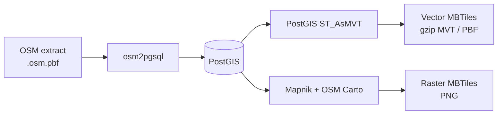
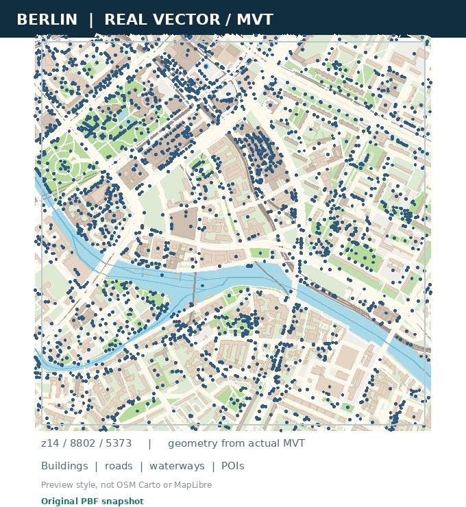
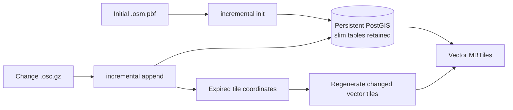
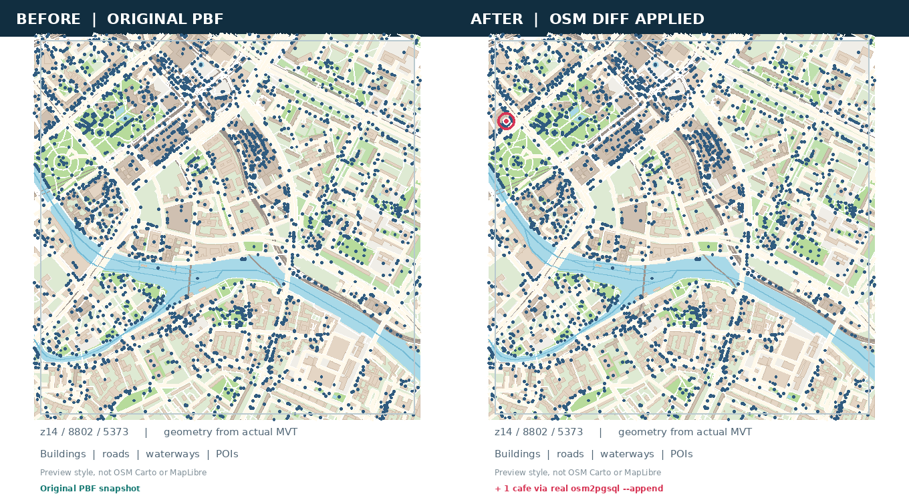

# osm2mbtiles

**OpenStreetMap PBF → Vector (MVT/PBF) and Raster (PNG) MBTiles, with OSM diff updates.**

[한국어 README](README.ko.md) · [Benchmarks & methodology](docs/BENCHMARKS.md) · [Tests](tests/README.md)

Turn a local **`.osm.pbf` extract** into an MBTiles archive using **osm2pgsql + PostGIS**. Export detailed vector layers, render raster tiles with Mapnik/OSM Carto, or generate both. A separate **persistent vector pipeline** can apply OSM `.osc.gz` changes without repeating the entire PBF import.

> **Source-based prototype, not a standalone binary.** Linux or WSL2 and a prepared native PostgreSQL/PostGIS, osm2pgsql, and (for raster) Mapnik/OSM Carto runtime are required. The initial vector exporter and the persistent vector incremental updater use **different database setups**. Windows runs through WSL2; native Windows binaries are not supplied.

## At a glance

| Input | Output | Command |
|---|---|---|
| OSM `.osm.pbf` | Vector MVT/PBF `.mbtiles` | `--tile-type vector` |
| OSM `.osm.pbf` | Raster PNG `.mbtiles` | `--tile-type raster` |
| OSM `.osm.pbf` | Both archives | `--tile-type both` |
| OSM `.osc.gz` | Updated **vector** MBTiles | `vector_incremental append` |

**OSM PBF** is the input data format; **MVT/PBF** is the vector tile payload stored inside SQLite-based **MBTiles**. The two kinds of PBF are not interchangeable. Vector tiles need a client-side map style to display as a map.

## How it works



`--tile-type both` uses a shared import path. The standard `convert` command normally manages its own local DB workspace; **this is not an append-ready database**.

## Quick start

### Windows + WSL2

From a source checkout, with WSL2 Ubuntu/Debian and its runtime installed:

```bat
run.bat vector 12-14
run.bat both 12-14
```

The launcher selects a local `.osm.pbf` file (you can also drag a PBF onto `run.bat`). These commands are for **Command Prompt / Windows**, not a Linux shell.

For the Seoul-specific manual smoke test, use `tests\test-seoul.bat` (not the default launcher).

### Linux / WSL: vector from PBF

From the repository root, after preparing the [native runtime](#requirements):

```bash
python3 -m pip install -e .

python3 -m osm2mbtiles convert berlin-261001.osm.pbf \
  --bbox 13.20,52.45,13.60,52.60 --zoom 12-14 \
  --tile-type vector --runtime ./runtime \
  --output berlin.mbtiles

python3 -m osm2mbtiles verify-vector berlin.mbtiles
```

Use a local Geofabrik [Berlin extract](https://download.geofabrik.de/europe/germany/berlin.html); it is **not downloaded automatically** by this command. The explicit `--bbox` is important when a PBF lacks an OSM header bounding box.

To generate **both** formats, replace `--tile-type vector` with `--tile-type both`. The output names become `berlin.raster.mbtiles` and `berlin.vector.mbtiles`. Raster rendering additionally needs the Mapnik/OSM Carto style, fonts and any external style resources.

## See the output



*Real Geofabrik Berlin PBF → PostGIS → MVT → image preview. The screenshot uses a minimal preview palette to visualize decoded tile geometry; it is **not** the bundled OSM Carto raster style or a MapLibre style.*

## Vector layers and feature properties

The default vector exporter writes **19 named MVT layers** with OSM-derived attributes. Client styles should use the exact `source-layer` IDs below; the minimum zoom indicates when a layer becomes eligible, not that every tile contains features.

| Category | Layer IDs | Example properties |
|---|---|---|
| Roads and transit | `road`, `pathway`, `railway`, `transport`, `aeroway` | `class`, `highway`, `surface`, `maxspeed` |
| Water and land | `water`, `waterway`, `landcover`, `landuse`, `leisure` | `natural`, `waterway`, `landuse` |
| Buildings and facilities | `building`, `building_part`, `aeroway_area`, `power` | `building`, `building:levels`, `height` |
| Places and addresses | `place`, `poi`, `housenumber` | `name`, `name:ko`, `amenity`, `addr:housenumber` |
| Boundaries | `boundary`, `boundary_legal` | `boundary`, `admin_level` |

**Important:** `class` is selected from each layer's relevant OSM tags, and `osm_id` is a **generated string**, not a raw numeric OSM ID. Only selected string-valued tags are exposed: z0–12 has **20** permitted original tag keys; z13+ has **74**. Properties are sparse, and the high-zoom fields are **not all present at lower zooms**.

**[Full vector layer & attribute reference →](docs/VECTOR-TILE-SCHEMA.md)** — exact minimum zooms, geometry, inclusion filters, `class` priorities, complete field lists, MapLibre source-layer example, and a copy-paste Python command to inspect real tile properties.

### Incremental vector updates

Initialize a **fresh, dedicated persistent** PostGIS database once, then apply `.osc.gz` diffs. This is separate from the disposable DB used by `convert`.



```bash
# Point these to an already running, dedicated PostGIS DB.
export PGHOST=/path/to/socket PGPORT=5432 PGUSER=your_user PGDATABASE=gis

python3 -m osm2mbtiles.vector_incremental init \
  --pbf berlin-261001.osm.pbf --output berlin-updated.mbtiles \
  --bbox 13.20,52.45,13.60,52.60 --zoom 12-14

python3 -m osm2mbtiles.vector_incremental append \
  --diff changes.osc.gz --output berlin-updated.mbtiles

# Only when the diff was applied but tile writing still needs recovery:
python3 -m osm2mbtiles.vector_incremental flush \
  --output berlin-updated.mbtiles
```



*The same Berlin vector tile before/after applying a **synthetic café POI** change through real osm2pgsql `--append`. This is a reproducible demonstration, not a live replication feed.*

The incremental path updates **vector tiles only** and retains OSM middle data so osm2pgsql can resolve changes. It does **not** include automatic replication downloads/sequence tracking, PNG incremental rendering, or guaranteed large-region unattended operation. An uncertain failed diff must **not** be blindly replayed.

## Requirements

- **Linux or Windows WSL2** (Ubuntu/Debian); source checkout required for top-level `vector/` assets.
- **Python 3.10+**, **PostgreSQL + PostGIS + osm2pgsql** for PBF import and vector export.
- The current `convert` CLI validates a complete `./runtime` layout **even in vector-only mode**: native PostgreSQL tools, a Mapnik-compatible Python executable, and OSM Carto style files must be present. MVT geometry itself is still generated by PostGIS, not Mapnik.
- **Raster PNG** additionally needs usable Mapnik/OSM Carto rendering, fonts and external style resources. `pip install` alone does not install the native runtime or styles.

Verify CLI options with `python3 -m osm2mbtiles --help`, or check a native runtime with `python3 -m osm2mbtiles doctor --runtime ./runtime`.

## Validation and limits

The repository has GitHub Actions coverage for Python tests, real Mapnik PNG smoke rendering, and synthetic OSM diff versus independent full-rebuild feature parity. Berlin vector export benchmarks preserve pinned PBF checksums and measure cold and warm stages separately.

**No generalized fastest-converter claim:** the primary comparison region is **Berlin**, while **Monaco** is a small smoke-test extract. Historical **Planetiler** and **Tilemaker** comparisons use different feature profiles; machine environments and cold/warm work also differ. See the [Berlin benchmark protocol](docs/BENCHMARKS.md), [output stability](docs/OUTPUT-STABILITY-REGRESSION.md) and [update lifecycle limitations](docs/UPDATE-LIFECYCLE-BENCHMARK.md).

**Attribution:** Project [MIT](LICENSE). Map data © [OpenStreetMap contributors](https://www.openstreetmap.org/copyright), subject to ODbL and attribution. Mapnik, OSM Carto, fonts, PostgreSQL/PostGIS and other dependencies retain their own licenses.
