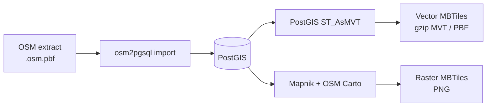
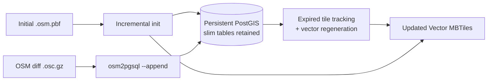

# osm2mbtiles

**Build Vector + Raster MBTiles from OSM PBF. Keep vector tiles updated with OSM diffs.**

[한국어 README](README.ko.md) · [Vector layers & properties](docs/VECTOR-TILE-SCHEMA.md) · [Benchmarks](docs/BENCHMARKS.md)

**Built for maps that change.** Convert an OpenStreetMap `.osm.pbf` extract into **MVT/PBF vector MBTiles**, **Mapnik-rendered PNG raster MBTiles**, or both. When OpenStreetMap data changes, a **separate persistent PostGIS vector workflow** can apply `.osc.gz` diffs and regenerate affected vector tiles without importing the entire PBF again.

**Why choose it?**

- **Maintain vector maps:** apply OSM changes to retained PostGIS state instead of starting every update from a full PBF import.
- **Vector + Raster:** export both MBTiles formats from a shared OSM import path when you need both.
- **Understand your output:** 19 documented MVT layers, defined attributes, and tested incremental/full-rebuild feature parity.

<details>
<summary>Before you start: native dependencies</summary>

This is a **source-based prototype**, not a single executable. Linux or Windows WSL2 (Ubuntu/Debian) needs PostgreSQL/PostGIS and osm2pgsql. **Vector-only conversion can use system tools without Mapnik or OSM Carto**; raster or `both` still requires the prepared full runtime. See [Requirements & limitations](#requirements--limitations).
</details>

## See a real OSM change


**Same Berlin z14 MVT tile, one OSM edit:** an explicitly **synthetic café** is added through real `osm2pgsql --append`; the decoded `poi` layer changes from **2,875 → 2,876** features. These are genuine output tiles from the [pinned Berlin PBF](docs/assets/readme-preview-evidence.json), **not** a live map feed. The image is a magnified diagnostic rendering of actual vector geometries, not an OSM Carto or MapLibre style. [See the full-tile before/after](docs/assets/berlin-incremental-before-after.png).

## Quick start

### Windows + WSL2

From a source checkout, after setting up WSL2 Ubuntu/Debian and the native runtime:

```bat
run.bat vector 12-14
run.bat both 12-14
```

Choose an existing local `.osm.pbf` in the launcher (or drag one onto `run.bat`). These commands run in Windows Command Prompt. For a Seoul-only **manual** smoke test, use `tests\test-seoul.bat`.

### Linux / WSL: PBF → Vector MBTiles

From the repository root, with **system PostgreSQL/PostGIS and osm2pgsql installed** (no Carto style or Mapnik needed for vector only):

```bash
python3 -m pip install -e '.[vector]'
python3 -m osm2mbtiles doctor --vector-only

# Download a local Berlin PBF first; the command does not download data.
python3 -m osm2mbtiles convert berlin-261001.osm.pbf \
  --bbox 13.20,52.45,13.60,52.60 --zoom 12-14 \
  --tile-type vector --output berlin.mbtiles

python3 -m osm2mbtiles verify-vector berlin.mbtiles
```

Get the [Geofabrik Berlin OSM PBF](https://download.geofabrik.de/europe/germany/berlin.html) beforehand. An explicit `--bbox` also works when the extract lacks a PBF header bounding box. To generate **both** formats, use `--tile-type both --runtime ./runtime` with a fully prepared raster runtime: this creates `berlin.vector.mbtiles` and `berlin.raster.mbtiles` from a shared import. Raster still needs Mapnik/OSM Carto, fonts and external assets.

### Apply OSM diffs to persistent **vector** tiles

The normal `convert` database is **not append-ready**. Initialize a new, dedicated PostGIS database for incremental updates, and retain its osm2pgsql slim tables:

```bash
# An existing, dedicated PostGIS service/database must be prepared.
export PGHOST=/path/to/socket PGPORT=5432 PGUSER=your_user PGDATABASE=gis

python3 -m osm2mbtiles.vector_incremental init \
  --pbf berlin-261001.osm.pbf --output berlin-updated.mbtiles \
  --bbox 13.20,52.45,13.60,52.60 --zoom 12-14

python3 -m osm2mbtiles.vector_incremental append \
  --diff changes.osc.gz --output berlin-updated.mbtiles
```

If a diff was applied successfully but tile writing remains pending, `python3 -m osm2mbtiles.vector_incremental flush --output berlin-updated.mbtiles` retries **tile writes only**, not the OSM diff. Do not blindly replay an uncertain failed diff. This path is **experimental and vector-only**; it does not manage replication sequences or download OSM diffs automatically.

## When should you choose osm2mbtiles?

| Your primary need | Tool to consider | Trade-off |
|---|---|---|
| Keep an existing vector map updated from OSM `.osc.gz` changes, generate **vector tiles using system PostGIS without Mapnik**, or produce both vector and PNG raster MBTiles | **osm2mbtiles** | PostGIS/osm2pgsql setup; experimental incremental path needs a persistent DB, raster requires a separate full runtime |
| Generate a large vector tile archive from a PBF snapshot with strong full-build throughput | [Planetiler](https://github.com/onthegomap/planetiler#readme) | Planetiler's own README says it processes full PBF imports rather than incorporating real-time updates |
| Create vector MBTiles/PMTiles without a database, especially for one-off exports | [Tilemaker](https://github.com/systemed/tilemaker#readme) | Tilemaker explicitly does not recommend itself for continuously updated OSM data |

The difference is **workflow**, not a proven speed win. Planetiler and Tilemaker are easier choices if you do not need persistent OSM diff updates or PNG generation inside this project. We do **not** claim that osm2mbtiles is generally faster, simpler to install, or compatible with those projects' layer schemas. [Benchmark conditions](docs/BENCHMARKS.md).

## How it works



The `--tile-type both` command uses the shared-import path. **OSM PBF** is original OSM data; **MVT/PBF** is the protobuf vector tile payload in SQLite MBTiles, and requires a suitable client-side map style.



Incremental updates use a **separate, persistent** PostGIS installation. The code refreshes derived label data as part of append processing and updates expired vector tile coordinates; do not infer that every database operation is limited to the changed objects.

## What is inside the Vector MBTiles?


*Berlin vector tiles shown with a minimal diagnostic preview palette, not a bundled MapLibre/OSM Carto cartographic style.*

The exporter has **19 logical MVT layers** and selected OSM-derived attributes:

| Feature group | Vector `source-layer` IDs |
|---|---|
| Roads and transport | `road`, `pathway`, `railway`, `transport`, `aeroway` |
| Land and water | `water`, `waterway`, `landcover`, `landuse`, `leisure` |
| Buildings and facilities | `building`, `building_part`, `aeroway_area`, `power` |
| Places and addresses | `place`, `poi`, `housenumber` |
| Boundaries | `boundary`, `boundary_legal` |

Generated `class` and `osm_id` are strings. OSM tag values are sparse: **20 allowlisted keys at z0–12** and **74 at z13+**. Not all attributes are present on every feature.

**[Full layer / attribute schema](docs/VECTOR-TILE-SCHEMA.md)** — minimum zoom, geometry, tag filtering, exact property keys, MapLibre style fragment and a Python example reading real MBTiles features.

## Live conversion progress

The source CLI and Windows WSL2 launcher print **live stage markers** such as `[CHECK]`, `[SETUP]`, `[IMPORT]`, `[RASTER]`, `[VECTOR]`, `[STAGE]` and `[TIME]`. During Raster, default Vector and experimental Vector Batch export, progress is based on **actual scheduled XYZ tiles**, not an estimate of the full PBF import.

```text
[STAGE] 3/5 — Importing PBF and exporting tiles (progress shown per phase)
[IMPORT] osm2pgsql still running | elapsed=00:20 | total work unknown
[RASTER] START | total=100 tiles | metatiles=3 | already-complete=20 | 20.0%
[RASTER]  60.0% | 60/100 tiles | 8.0 tiles/s | ETA 00:00:05
[VECTOR] 100.0% | 100/100 tiles | 45.0 tiles/s | ETA 00:00:00
```

These are **format examples**, not performance measurements. Mapnik Raster percentages include already written tiles when resuming a matching partial MBTiles. Rendering and long SQL calls also emit a `WORKING`/elapsed heartbeat if no tile has finished for a while. Import and external GIS download steps have **no reliable overall percentage or ETA**, so only elapsed time and live native tool output are shown. A `COMPLETE` result requires finishing the corresponding tile task; final MBTiles verification remains a separate step.

## Requirements & limitations

- **Linux / Windows WSL2** and a source checkout (the top-level `vector/` flex assets are not packaged into a standalone wheel).
- **Vector-only:** Python 3.10+ (`python3 -m pip install -e '.[vector]'`), system PostgreSQL/PostGIS and osm2pgsql. The CLI locates PostgreSQL tools from the supplied runtime if present, otherwise from PATH or Ubuntu/Debian's versioned PostgreSQL binary directory. **No Mapnik, OSM Carto, or prepared `./runtime` is required.** The PostGIS extension must be installed on the host. Use `doctor --vector-only` to check native tools and Python psycopg2.
- **Raster or `both`:** the original full `./runtime` remains required: Mapnik-compatible Python, OSM Carto style, PostgreSQL tools, fonts and other style-dependent assets. Use `doctor --runtime ./runtime`. The project does **not** include a hosted tile server or ready-to-use MapLibre style.
- **Incremental updates are vector-only and experimental.** No PNG diff updates, automatic `.osc.gz` acquisition/sequence tracking, or claim of nationwide, unattended operation. Production schema changes can require a fresh persistent DB initialization.
- CI checks Python and shell behavior, real Mapnik PNG rendering and synthetic OSM diff vs independent full-rebuild feature parity. It does **not** certify every Windows/WSL system or universal MVT gzip-byte reproducibility between independent DB rebuilds.

Use `python3 -m osm2mbtiles doctor --vector-only` for the system vector tool check, or `python3 -m osm2mbtiles doctor --runtime ./runtime` for raster and combined output. A small **Monaco** input is suitable for smoke testing; **Berlin** is the primary benchmark region. See [reproducible benchmarks](docs/BENCHMARKS.md), [output stability](docs/OUTPUT-STABILITY-REGRESSION.md) and [update lifecycle limits](docs/UPDATE-LIFECYCLE-BENCHMARK.md).

**License & attribution:** Project [MIT](LICENSE). Map data © [OpenStreetMap contributors](https://www.openstreetmap.org/copyright) (ODbL/attribution). PostgreSQL/PostGIS, osm2pgsql, Mapnik/OSM Carto, fonts and external map data retain their respective licenses.
